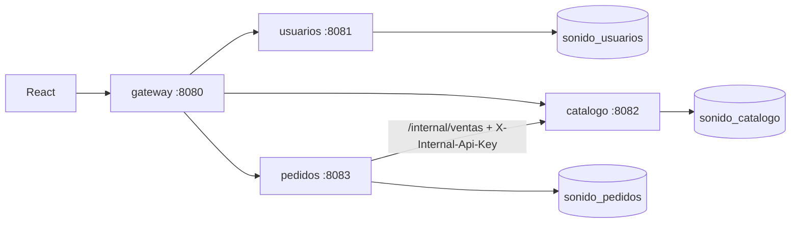

# Sonido Vivo — Backend de microservicios

Backend de la tienda online **Sonido Vivo** (DSY1104 Desarrollo Fullstack II, Duoc UC, Evaluación 3). Son **tres microservicios Spring Boot** y un **API Gateway**, con una instancia **MySQL de tres esquemas** y seguridad **JWT con roles**.

| Módulo | Puerto | Esquema MySQL | Responsabilidad |
|---|---:|---|---|
| `common` | — | — | Biblioteca compartida (no es un microservicio): errores uniformes, JWT, clave interna, Swagger, utilidades |
| `usuarios` | 8081 | `sonido_usuarios` | Login, registro (siempre Cliente), `/auth/me`, perfil y CRUD de usuarios. **Emite el JWT** |
| `catalogo` | 8082 | `sonido_catalogo` | Categorías y productos: CRUD, filtros, ofertas, críticos. **Dueño del stock** |
| `pedidos` | 8083 | `sonido_pedidos` | Checkout (boletas desde 1001), historial y reportes |
| `gateway` | 8080 | — | Único punto de entrada del frontend: rutas `/api/v1/**`, CORS y Swagger agregado |



Cada microservicio sigue la misma organización: `controller` → `service` → `repository` → `model`, con `dto`, `exception` y `config` (más `client` y `mapper` en pedidos). No hay relaciones JPA ni claves foráneas entre esquemas. Los servicios se referencian por ID (RUN, código de producto) y se comunican por HTTP. El frontend está en `../proyecto_Etapa3_REACT`.

## Requisitos

- **JDK 21** o superior. El código se compila para Java 21 (`--release 21`) y está probado también con JDK 26.
- Maven Wrapper incluido (`mvnw` / `mvnw.cmd`); la primera vez descarga Maven y las dependencias.
- Opcional: **Docker Desktop** (para MySQL y los 4 servicios en contenedores).
- Opcional: MySQL 8 local, si se quiere ejecutar sin Docker contra MySQL.

## Variables de entorno

Copia `.env.example` como `.env` y reemplaza todos los valores `REEMPLAZAR_...`. El archivo `.env` **nunca** se sube a git.

| Variable | Usada por | Descripción |
|---|---|---|
| `JWT_SECRET` | usuarios, catalogo, pedidos | Secreto HS256 **compartido**, en Base64 y de al menos 32 bytes. Generar con `openssl rand -base64 48` |
| `JWT_EXPIRACION_MINUTOS` | usuarios | Vigencia del token (120 por defecto) |
| `INTERNAL_API_KEY` | catalogo, pedidos | Clave de la llamada interna pedidos → catalogo. Generar con `openssl rand -hex 32` |
| `CORS_ORIGINS` | gateway | Orígenes del frontend separados por coma (por defecto `http://localhost:5173,http://localhost:4173`) |
| `MYSQL_ROOT_PASSWORD` | contenedor MySQL | Solo para `compose.yaml` |
| `DB_HOST`, `DB_PORT` | compose | Host de MySQL (`mysql` en Docker, `localhost` en local) |
| `DB_USUARIOS_USER` / `_PASSWORD`, `DB_CATALOGO_USER` / `_PASSWORD`, `DB_PEDIDOS_USER` / `_PASSWORD` | cada servicio | Usuario MySQL de cada esquema (`sv_usuarios`, `sv_catalogo`, `sv_pedidos`) |
| `DDL_AUTO` | servicios | `update` crea las tablas en el primer arranque; después conviene `validate` |

Al ejecutar un jar a mano, cada servicio lee `DB_URL`, `DB_USER`, `DB_PASSWORD`, `PORT`, `CATALOGO_URL` (pedidos) y `USUARIOS_URL`/`CATALOGO_URL`/`PEDIDOS_URL` (gateway). Los valores por defecto apuntan a `localhost`. En el perfil `mysql`, `JWT_SECRET`, `INTERNAL_API_KEY` y `DB_PASSWORD` son **obligatorios**: sin ellos el servicio no arranca.

## Cómo ejecutar

### 1. Con H2, sin instalar nada más (desarrollo y plan B)

```powershell
.\mvnw.cmd -DskipTests package
powershell -ExecutionPolicy Bypass -File scripts\iniciar-h2.ps1          # Gateway en http://localhost:8080
powershell -ExecutionPolicy Bypass -File scripts\iniciar-h2.ps1 -Detener
```

El perfil por defecto es `h2`: cada servicio guarda su base en un archivo dentro de `scripts/salida/<servicio>/data` y usa secretos de desarrollo. También se puede iniciar un servicio solo: `java -jar catalogo/target/catalogo-1.0.0.jar`.

### 2. Con MySQL local

1. Edita las tres contraseñas de `sql/01_crear_esquemas_mysql.sql` y ejecútalo como administrador: `mysql -u root -p < sql/01_crear_esquemas_mysql.sql`. Crea los 3 esquemas y 3 usuarios, cada uno con `GRANT` solo sobre su esquema.
2. Inicia cada servicio con el perfil `mysql`. Ejemplo para catálogo en PowerShell:

```powershell
$env:SPRING_PROFILES_ACTIVE="mysql"; $env:JWT_SECRET="<el mismo en los 3>"; $env:INTERNAL_API_KEY="<la misma en catalogo y pedidos>"
$env:DB_URL="jdbc:mysql://localhost:3306/sonido_catalogo?useSSL=false&allowPublicKeyRetrieval=true&serverTimezone=UTC"
$env:DB_USER="sv_catalogo"; $env:DB_PASSWORD="<contraseña del SQL>"
java -jar catalogo\target\catalogo-1.0.0.jar
```

Repite lo mismo con `usuarios` (`sonido_usuarios`, `sv_usuarios`) y `pedidos` (`sonido_pedidos`, `sv_pedidos`), y luego inicia `gateway` (no usa base de datos). En IntelliJ: importa `pom.xml` como proyecto Maven y crea una configuración por `*Application` con esas variables.

### 3. Con Docker (MySQL + 4 servicios)

```powershell
copy .env.example .env          # y reemplazar los valores REEMPLAZAR_...
docker compose up --build -d
docker compose ps               # los 5 contenedores deben quedar "healthy"
docker compose down             # detiene y conserva los datos (no uses -v si quieres conservarlos)
```

El contenedor MySQL ejecuta `sql/docker/01_init.sh` la primera vez: crea los esquemas y usuarios con las contraseñas del `.env`. **Solo el Gateway publica un puerto (8080)**; los microservicios y MySQL quedan en la red interna de Docker.

## Swagger

<http://localhost:8080/swagger-ui.html>: un selector con un documento por servicio (Usuarios, Catálogo y Pedidos).

1. En **Usuarios**, ejecuta `POST /api/v1/auth/login` y copia el `token`.
2. Pulsa **Authorize** y pégalo. Al cambiar de documento, vuelve a autorizar con el mismo token.

Especificaciones OpenAPI: el Gateway las sirve en `/openapi/usuarios`, `/openapi/catalogo` y `/openapi/pedidos` con el sistema en ejecución.

## Cuentas de demostración

| Rol | Correo | Contraseña | Puede |
|---|---|---|---|
| Administrador | maria.perez@gmail.com | admin123 | Todo |
| Vendedor | carlos.munoz@duoc.cl | vend123 | Solo ver productos y órdenes (lista y detalle) |
| Cliente | camila.rojas@gmail.com | cli123 | La tienda, sus compras y su perfil |

Las carga la semilla de `usuarios` si la tabla está vacía (contraseñas con BCrypt). `catalogo` carga 10 categorías y 51 productos; `pedidos` empieza vacío.

## Pruebas

```powershell
.\mvnw.cmd clean verify                                     # pruebas de todos los módulos + JaCoCo
powershell -ExecutionPolicy Bypass -File scripts\humo.ps1    # de punta a punta contra el Gateway en marcha
```

Último resultado (17-11-2026): **48 pruebas, 0 fallos**. Por módulo: common 4, usuarios 10, catalogo 15, pedidos 17 y gateway 2. JaCoCo mide solo la lógica (paquetes `controller` y `service`) y el build falla si un módulo baja del 80 % de líneas: 91,7 % de líneas y 87,9 % de ramas en total (usuarios 90,9 %, catalogo 88,6 %, pedidos 95,3 %; informe en `<módulo>/target/site/jacoco/index.html`).

Las pruebas se concentran en lo importante: reglas de negocio de cada servicio con Mockito (`UsuarioServiceTest`, `CatalogoReglasTest`, `VentaServiceTest`, `BoletaServiceTest`, `ReporteServiceTest`), el JWT (`JwtUtilTest`), una prueba de API por servicio para login y permisos por rol, y el enrutamiento del Gateway. Usan H2 en memoria (`src/test/resources/application-h2.yml`) y no necesitan MySQL; en `pedidos`, el cliente de catálogo se simula con Mockito.
