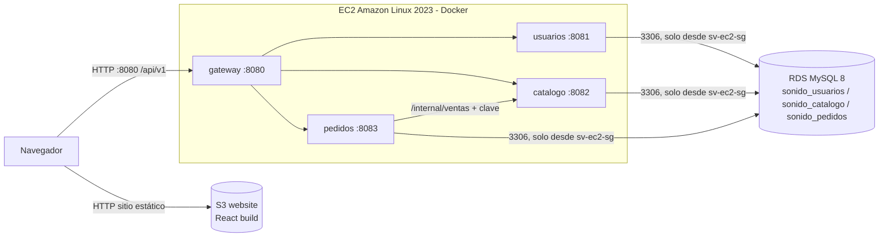

# Despliegue en AWS Academy (Learner Lab)

Guía para publicar Sonido Vivo en AWS con **una RDS MySQL 8** (3 esquemas), **una EC2** con los 4 contenedores (usuarios, catálogo, pedidos y Gateway) y el **frontend en S3**.

> **Estado:** estos archivos y scripts **no se han ejecutado** en ninguna cuenta de AWS. Están listos para que el equipo los corra durante su sesión del laboratorio.



| Recurso | Configuración | Por qué |
|---|---|---|
| RDS | MySQL 8.0, `db.t3.micro`, 20 GB gp2, **no pública**, sin Multi-AZ, sin respaldos | La pauta exige MySQL; es la opción más barata del laboratorio |
| `sv-rds-sg` | Entrada 3306 **solo desde `sv-ec2-sg`** | La base no se puede alcanzar desde Internet |
| EC2 | Amazon Linux 2023, `t3.small` (o `t3.medium` si el laboratorio lo permite), 20 GB | Corre los 4 contenedores con Docker |
| `sv-ec2-sg` | 22 desde tu IP, 8080 desde `0.0.0.0/0` | Solo se publica el Gateway; 8081-8083 quedan dentro de Docker |
| S3 | Sitio web estático, lectura pública | Frontend compilado con la URL del Gateway |

## 0. Antes de empezar

1. Inicia el laboratorio (**Start Lab**) y espera el círculo verde.
2. En **AWS Details > AWS CLI > Show**, copia las tres líneas (`aws_access_key_id`, `aws_secret_access_key`, `aws_session_token`) a `C:\Users\<tu-usuario>\.aws\credentials` bajo `[default]`. Descarga también `labsuser.pem` (**Download PEM**).
3. Instala AWS CLI v2 (<https://aws.amazon.com/cli/>) y comprueba la sesión: `aws sts get-caller-identity`.
4. Trabaja en la región **us-east-1** (la del laboratorio).

## 1-3. Crear RDS, Security Groups y EC2

**Con script** (desde la raíz de `backend-microservicios`, en PowerShell):

```powershell
powershell -ExecutionPolicy Bypass -File aws/aprovisionar.ps1 -RdsPassword 'ClaveAdminSegura123' -IpElastica
```

El script crea los dos Security Groups, la RDS `sonido-vivo-mysql`, la EC2 `sonido-vivo-backend` (con `aws/ec2-user-data.sh`, que instala Docker, docker compose, git y 2 GB de swap) y una IP elástica opcional. Al final imprime la **IP de la EC2** y el **endpoint de RDS**.

**A mano en la consola** (equivalente):

1. *EC2 > Security Groups > Create*: `sv-ec2-sg` (entrada 22 desde *My IP* y 8080 desde *Anywhere-IPv4*), y `sv-rds-sg` (entrada *MYSQL/Aurora* 3306 con origen **el grupo `sv-ec2-sg`**).
2. *RDS > Create database > Standard create > MySQL 8.0*: plantilla **Free tier/Dev**, identificador `sonido-vivo-mysql`, usuario `admin`, clase `db.t3.micro`, 20 GB, *Public access: No*, VPC por defecto, grupo `sv-rds-sg`, sin respaldos automáticos.
3. *EC2 > Launch instance*: Amazon Linux 2023, `t3.small`, par de llaves `vockey`, grupo `sv-ec2-sg`, 20 GB. En *Advanced details*: *IAM instance profile* = `LabInstanceProfile` y en *User data* pega el contenido de `aws/ec2-user-data.sh`.

## 4. Preparar el servidor

```bash
ssh -i labsuser.pem ec2-user@<IP-EC2>
cat ~/LISTO.txt                      # aparece cuando el user data terminó (2-4 minutos)
git clone https://github.com/<usuario>/<repo-backend>.git sonido-vivo && cd sonido-vivo
```

### Crear los 3 esquemas y usuarios en RDS

Edita las tres contraseñas `CAMBIAR_...` de `sql/01_crear_esquemas_mysql.sql` y ejecútalo con un cliente MySQL **dentro de un contenedor** (no hace falta instalarlo en la EC2):

```bash
nano sql/01_crear_esquemas_mysql.sql
docker run --rm -i mysql:8.4 mysql -h <ENDPOINT-RDS> -u admin -p < sql/01_crear_esquemas_mysql.sql
docker run --rm -it mysql:8.4 mysql -h <ENDPOINT-RDS> -u admin -p -e "SHOW DATABASES; SHOW GRANTS FOR 'sv_catalogo'@'%';"
```

### Variables de entorno (solo en el servidor)

```bash
cp aws/.env.aws.example .env
openssl rand -base64 48   # -> JWT_SECRET
openssl rand -hex 32      # -> INTERNAL_API_KEY
nano .env                 # DB_HOST = endpoint de RDS; contraseñas iguales a las del SQL; CORS_ORIGINS con la URL de S3
chmod 600 .env
```

## 5. Levantar el backend

```bash
docker compose --env-file .env -f aws/compose.rds.yaml up -d --build   # la primera compilación tarda varios minutos
docker compose --env-file .env -f aws/compose.rds.yaml ps              # los 4 deben quedar "healthy"
curl http://localhost:8080/actuator/health
```

Hibernate crea las tablas en el primer arranque (`DDL_AUTO=update`) y la semilla carga los 3 usuarios, 10 categorías y 51 productos. Después del primer arranque correcto se recomienda `DDL_AUTO=validate` en `.env`.

Comprobación desde tu PC: `powershell -ExecutionPolicy Bypass -File scripts/humo.ps1 -Gateway http://<IP-EC2>:8080` debe terminar con **0 fallas**. Swagger: `http://<IP-EC2>:8080/swagger-ui.html`.

## 6. Frontend en S3

Desde `fase3/proyecto_Etapa3_REACT` en tu PC:

```powershell
powershell -ExecutionPolicy Bypass -File aws/deploy-s3.ps1 -Bucket sonido-vivo-<equipo> -ApiUrl http://<IP-EC2>:8080/api/v1
```

El script exporta `VITE_API_URL` **antes** de `npm run build` (Vite incrusta la URL al compilar), crea el bucket, lo publica como sitio web y muestra su URL. Luego, en la EC2, agrega esa URL a `CORS_ORIGINS` del `.env` y recrea el Gateway:

```bash
docker compose --env-file .env -f aws/compose.rds.yaml up -d gateway
```

### HTTP y HTTPS

- El endpoint de sitio web de S3 es **solo HTTP**, y el Gateway también es HTTP: la combinación funciona.
- Si se pone **CloudFront** delante del sitio (HTTPS), el navegador **bloquea** las llamadas a una API HTTP (*mixed content*). En ese caso la API también debe ser HTTPS, por ejemplo con otra distribución de CloudFront cuyo origen sea `http://<IP-EC2>:8080`, o con un balanceador con certificado (este último requiere dominio propio). Para la presentación basta HTTP.
- `crypto.randomUUID` no existe en sitios HTTP; por eso el checkout genera su `Idempotency-Key` con `crypto.getRandomValues`.

## Notas de AWS Academy

- **La sesión dura unas 4 horas.** Al terminar, las EC2 se detienen y se reinician en la siguiente sesión. Revisa en la consola el estado de la RDS al volver.
- **Las credenciales rotan en cada sesión.** Vuelve a copiar las tres líneas de *AWS Details* a `~/.aws/credentials` antes de usar AWS CLI o `deploy-s3.ps1`.
- **La IP pública de la EC2 cambia** cada vez que se detiene. Usa una **IP elástica** (`-IpElastica`) si el laboratorio lo permite. Si no, vuelve a ejecutar `deploy-s3.ps1` con la nueva IP y actualiza `CORS_ORIGINS`.
- **No se pueden crear roles IAM** (`LabRole` ya existe y no se modifica). La EC2 usa el perfil existente `LabInstanceProfile`. El backend no llama a servicios de AWS, así que no necesita más permisos.
- Los contenedores tienen `restart: unless-stopped`: al iniciar la instancia, Docker los levanta solos.
- **Cuida el crédito**: detén la EC2 y la RDS al terminar y elimínalas después de la evaluación (*RDS > Delete* sin snapshot final, *EC2 > Terminate*, libera la IP elástica y vacía y borra el bucket).

## Plan B (si el laboratorio falla el día de la presentación)

1. **Docker local con MySQL** (todo igual que en AWS, en tu PC), desde `backend-microservicios`:
   ```powershell
   copy .env.example .env      # y reemplazar los valores REEMPLAZAR_...
   docker compose up --build -d
   ```
2. **Sin Docker, con H2** (solo Java 21):
   ```powershell
   .\mvnw.cmd -DskipTests package
   powershell -ExecutionPolicy Bypass -File scripts/iniciar-h2.ps1
   ```
3. Frontend: en `proyecto_Etapa3_REACT`, `npm run dev` (usa `http://localhost:8080/api/v1`) y abre <http://localhost:5173>.
4. Para la evidencia: `scripts/humo.ps1` (debe terminar con 0 fallas) y Swagger en <http://localhost:8080/swagger-ui.html>.
