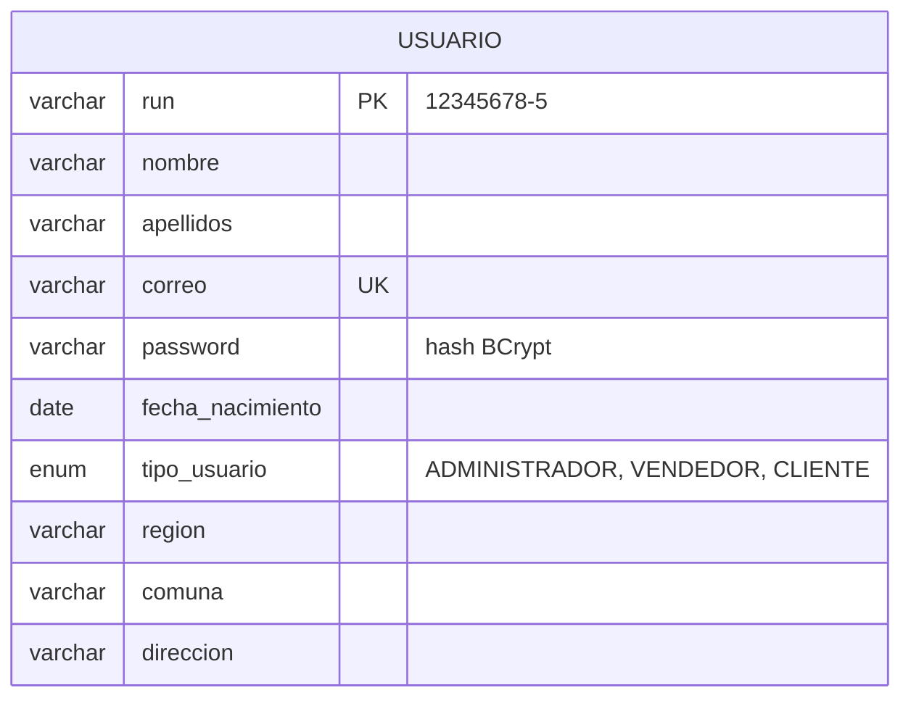
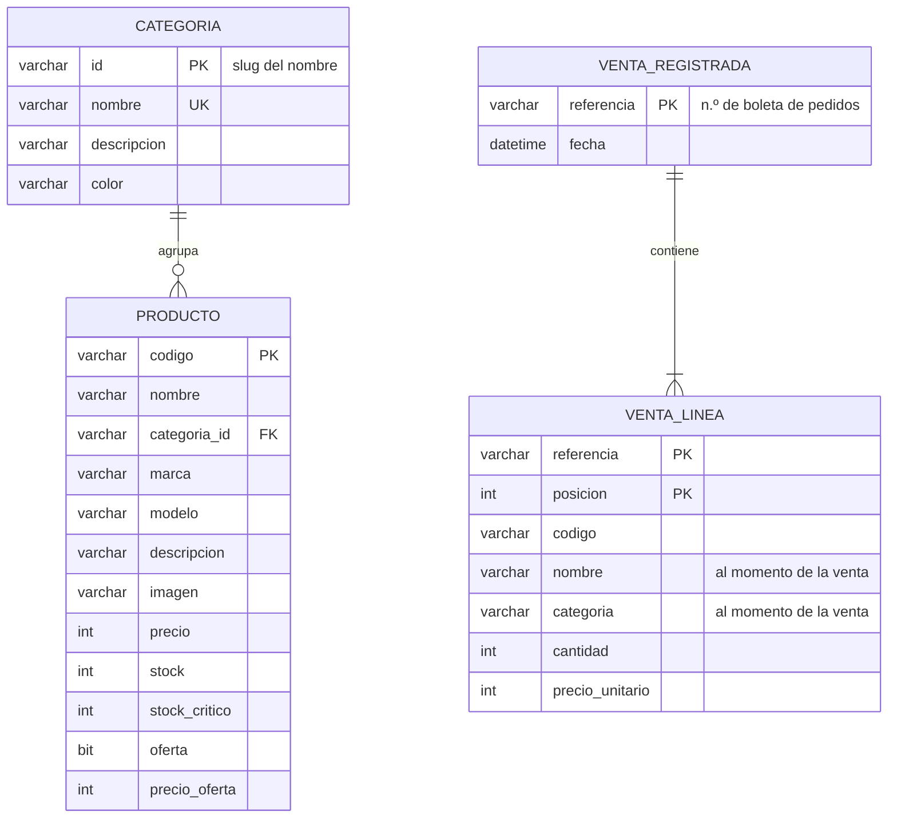
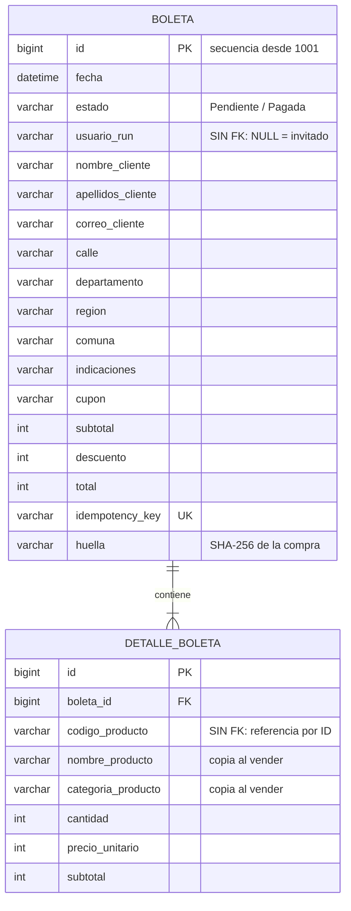

# Documento de APIs e Integración — Sonido Vivo (Etapa 3, microservicios)

Versión 3.1 · 10-11-2026 · DSY1104 Desarrollo Fullstack II · Evaluación Parcial 3

Este documento describe cómo se comunican el frontend React y el backend de **microservicios**: arquitectura, modelo de datos por esquema, seguridad con JWT, todos los endpoints con su rol, la llamada interna entre servicios y las pruebas realizadas, con sus resultados reales. Reemplaza al documento de la versión monolítica (`fase3/docs/APIs_e_Integracion.md`), que queda como respaldo junto a `fase3/sonido-vivo-api`.

---

## 1. Arquitectura

```mermaid
flowchart LR
  B[Navegador<br/>React + axios] -->|HTTP JSON /api/v1<br/>Authorization: Bearer JWT| G[API Gateway :8080<br/>rutas · CORS · Swagger]
  G -->|/auth/** · /usuarios/**| U[usuarios :8081]
  G -->|/productos/** · /categorias/**| C[catalogo :8082]
  G -->|/boletas/** · /reportes/**<br/>/usuarios/me/boletas · /usuarios/{run}/boletas| P[pedidos :8083]
  P -->|POST /internal/ventas<br/>GET /internal/inventario<br/>X-Internal-Api-Key| C
  U --> DU[(sonido_usuarios)]
  C --> DC[(sonido_catalogo)]
  P --> DP[(sonido_pedidos)]
  subgraph MySQL 8 - una instancia
    DU
    DC
    DP
  end
```

| Módulo | Puerto | Esquema MySQL | Usuario MySQL | Responsabilidad |
|---|---:|---|---|---|
| `common` | — | — | — | Biblioteca Maven (no es un microservicio): `ErrorRespuesta` y `ApiErrors` (errores uniformes), `JwtUtil` y `FiltroJwt`, `ClaveInternaFiltro`, `SeguridadBase`, `OpenApiConfig`, `Textos`/`Patrones` |
| `usuarios` | 8081 | `sonido_usuarios` | `sv_usuarios` | Cuentas, login, registro (siempre Cliente), `/auth/me`, perfil propio, CRUD de usuarios. **Único que emite el JWT** |
| `catalogo` | 8082 | `sonido_catalogo` | `sv_catalogo` | Categorías y productos (CRUD, filtros, ofertas, críticos). **Único que modifica el stock** (ruta interna) |
| `pedidos` | 8083 | `sonido_pedidos` | `sv_pedidos` | Boletas (checkout), historial por usuario y reportes de ventas |
| `gateway` | 8080 | — | — | Único punto de entrada del frontend: enruta `/api/v1/**`, aplica CORS y junta los tres Swagger. Sin base de datos |

**Organización interna de cada microservicio** (igual que en la referencia del docente): `controller` → `service` → `repository` → `model`, con `dto` para lo que entra y sale de la API, `exception` (su `GlobalExceptionHandler` hereda los manejadores de `common`) y `config` (`SecurityConfig` y `Seed`). `pedidos` agrega `client` (llamada HTTP a catálogo) y `mapper` (entidad → DTO).

**Decisiones clave (para la exposición):**
- **Una instancia MySQL, tres esquemas, tres usuarios.** Cada servicio solo tiene `GRANT` sobre su esquema. Es más barato que tres servidores (una sola RDS en AWS) y mantiene la regla de los microservicios: ningún servicio lee las tablas de otro.
- **Sin claves foráneas entre esquemas.** Los servicios se referencian por ID (RUN del comprador, código de producto) y se comunican por HTTP.
- **El navegador solo habla con el Gateway.** CORS se configura una sola vez y los puertos 8081 a 8083 no se publican fuera de Docker.
- **Mismas rutas y mismas respuestas que el monolito.** El frontend no cambió de URL: solo se agregó la `Idempotency-Key` del checkout (sección 6).

---

## 2. Modelo de datos por esquema

Las tablas las genera Hibernate (`ddl-auto=update`) en el primer arranque de cada servicio. El script `sql/01_crear_esquemas_mysql.sql` solo crea los esquemas y los usuarios. Columnas y claves obtenidas de `information_schema` del MySQL de `docker compose` (10-11-2026).

### 2.1 `sonido_usuarios`



### 2.2 `sonido_catalogo`



`VENTA_REGISTRADA` es el **comprobante propio de catálogo** por cada descuento de stock que pide pedidos. Sirve para dos cosas: hace la venta interna **idempotente** (la misma referencia no descuenta dos veces) y permite aplicar la regla *"no eliminar un producto que ya se vendió"* sin leer el esquema de pedidos.

### 2.3 `sonido_pedidos`



`boleta_seq` es la tabla con la que Hibernate emula en MySQL la secuencia de numeración, que parte en 1001.

### 2.4 Relaciones entre servicios (lógicas, no de base de datos)

| Desde | Hacia | Cómo se referencia | Consecuencia |
|---|---|---|---|
| `sonido_pedidos.boleta.usuario_run` | `sonido_usuarios.usuario.run` | RUN tomado del JWT (`sub`) | Al eliminar un usuario sus boletas **conservan el RUN** como dato histórico del comprador (el RUN identifica a la persona de forma única) |
| `sonido_pedidos.detalle_boleta.codigo_producto` | `sonido_catalogo.producto.codigo` | Código enviado por el carrito | El detalle guarda nombre, categoría y precio del momento: los reportes no consultan a catálogo y la boleta no cambia si el producto se edita |
| `sonido_catalogo.venta_registrada.referencia` | `sonido_pedidos.boleta.id` | Número de boleta que envía pedidos | Idempotencia de la venta interna |

**Comprobación real en MySQL:** las únicas claves foráneas son `producto → categoria` y `venta_linea → venta_registrada` (en `sonido_catalogo`) y `detalle_boleta → boleta` (en `sonido_pedidos`). No hay ninguna entre esquemas. `SHOW GRANTS FOR 'sv_catalogo'@'%'` devuelve solo `GRANT ALL PRIVILEGES ON sonido_catalogo.*`, y `sv_catalogo` recibe `ERROR 1142: SELECT command denied … for table 'usuario'` al intentar leer `sonido_usuarios`.

---

## 3. Seguridad

### 3.1 Flujo JWT con secreto compartido

```mermaid
sequenceDiagram
  participant F as Frontend
  participant G as Gateway
  participant U as usuarios
  participant P as pedidos
  F->>G: POST /api/v1/auth/login {correo, password}
  G->>U: (reenvía)
  U->>U: BCrypt.matches(password, hash)
  U-->>F: 200 {token, tipo: "Bearer", expiraEn, usuario}
  Note over F: token en sessionStorage;<br/>el interceptor de axios lo agrega a cada petición
  F->>G: GET /api/v1/boletas<br/>Authorization: Bearer <token>
  G->>P: (reenvía con el mismo encabezado)
  P->>P: FiltroJwt: firma HS256 + vencimiento con JWT_SECRET<br/>rol VENDEDOR -> ROLE_VENDEDOR
  P-->>F: 200 [boletas]  (o 401 sin token / 403 sin permiso)
```

- **Emisión:** solo `usuarios` firma (`JwtUtil.generar`). Contenido: `sub` = RUN, `rol`, `nombre`, `correo`, `iat` y `exp` (120 minutos por defecto, `JWT_EXPIRACION_MINUTOS`). Nunca incluye la contraseña.
- **Validación:** `catalogo` y `pedidos` validan el token con el **mismo** `JWT_SECRET` (Base64, mínimo 32 bytes, generado con `openssl rand -base64 48`) y sin llamar a `usuarios`. Con HS256, quien valida también podría firmar; por eso el secreto vive solo en variables de entorno de los servidores.
- **Contraseñas:** BCrypt. La respuesta nunca incluye `password`.
- **Sin estado:** sin sesión de servidor ni cookies, así que CSRF no aplica. El Gateway **no** valida el token: lo reenvía, y cada servicio aplica sus propias reglas de rol.
- **401 y 403** se responden con el mismo JSON de error que el resto de la API (`SeguridadBase`).

### 3.2 Clave interna entre servicios

`pedidos` llama a `catalogo` directamente (`CATALOGO_URL`, sin pasar por el Gateway) con el encabezado `X-Internal-Api-Key: ${INTERNAL_API_KEY}`. `ClaveInternaFiltro` compara la clave en tiempo constante y da el rol `SERVICIO_INTERNO`, que es el único que acepta `/internal/**`. Las barreras son tres:

1. El Gateway **no tiene ruta** para `/internal/**`: desde fuera responde 404.
2. En Docker, los puertos 8081 a 8083 no se publican; solo el 8080.
3. Aunque alguien llegue al servicio, sin la clave recibe 401. Un **Administrador con JWT** recibe 403: ni el personal puede descontar stock directamente.

### 3.3 Matriz de permisos

| Endpoint | Invitado | Cliente | Vendedor | Admin |
|---|:-:|:-:|:-:|:-:|
| `POST /auth/login`, `POST /auth/registro` | ✔ | ✔ | ✔ | ✔ |
| `GET /auth/me` | 401 | ✔ | ✔ | ✔ |
| `GET /productos`, `GET /productos/{codigo}`, `GET /categorias`, `GET /categorias/{id}` | ✔ | ✔ | ✔ | ✔ |
| `GET /productos/criticos` | 401 | 403 | 403 | ✔ |
| `POST/PUT/DELETE /productos/**`, `/categorias/**` | 401 | 403 | 403 | ✔ |
| `POST /boletas` (comprar) | ✔ | ✔ | ✔ | ✔ |
| `GET /boletas` | 401 | 403 | ✔ | ✔ |
| `GET /boletas/{id}` | 401 | solo las suyas (otra: 403) | ✔ | ✔ |
| `GET/PUT /usuarios/me` | 401 | ✔ | **403** | ✔ |
| `GET /usuarios/me/boletas` | 401 | ✔ | **403** | ✔ |
| `GET/POST/PUT/DELETE /usuarios/**`, `GET /usuarios/{run}/boletas` | 401 | 403 | 403 | ✔ |
| `GET /reportes/ventas` | 401 | 403 | 403 | ✔ |
| `/internal/**` (por el Gateway) | 404 | 404 | 404 | 404 |

**Vendedor:** según el enunciado solo ve la lista y el detalle de productos y de órdenes, además de `/auth/login` y `/auth/me` para que su sesión funcione. Las lecturas públicas del catálogo y el checkout son públicas para cualquiera. Cualquier otra ruta no listada responde 403 (`denyAll`).

---

## 4. Endpoints por microservicio

Base: `http://<gateway>:8080/api/v1`. Son 27 operaciones públicas (las mismas del monolito) y 2 internas. El detalle de esquemas y ejemplos está en Swagger y en `docs/openapi/{usuarios,catalogo,pedidos}.json`, exportados desde el Gateway en ejecución.

### 4.1 usuarios (8081)

| Método | Ruta | Rol | Respuestas | Descripción |
|---|---|---|---|---|
| POST | `/auth/login` | Público | 200, 400, 401 | Devuelve `{token, tipo, expiraEn, usuario}` |
| POST | `/auth/registro` | Público | 201, 400, 409 | Crea siempre un **Cliente** (ignora cualquier `tipoUsuario` enviado) e inicia la sesión |
| GET | `/auth/me` | Autenticado | 200, 401 | Datos del dueño del token |
| GET | `/usuarios/me` | Admin, Cliente | 200, 401, 403 | Perfil propio |
| PUT | `/usuarios/me` | Admin, Cliente | 200, 400, 401, 403 | No cambia RUN, correo ni tipo; contraseña vacía = se conserva |
| GET | `/usuarios` | Admin | 200, 401, 403 | Lista ordenada por RUN |
| GET | `/usuarios/{run}` | Admin | 200, 404 | — |
| POST | `/usuarios` | Admin | 201, 400, 409 | Cualquier rol; RUN válido y único, correo único |
| PUT | `/usuarios/{run}` | Admin | 200, 400, 404, 409 | El RUN de la URL manda; contraseña vacía = se conserva |
| DELETE | `/usuarios/{run}` | Admin | 204, 404, 409 | 409 si intenta eliminarse a sí mismo |

### 4.2 catalogo (8082)

| Método | Ruta | Rol | Respuestas | Descripción |
|---|---|---|---|---|
| GET | `/productos?categoria=&q=&oferta=` | Público | 200 | Filtros combinables por categoría (id), texto (nombre, marca, modelo, código) y ofertas |
| GET | `/productos/criticos` | Admin | 200, 401, 403 | `stock <= stockCritico` |
| GET | `/productos/{codigo}` | Público | 200, 404 | Incluye `precioVigente` y `critico` |
| POST | `/productos` | Admin | 201, 400, 409 | Código único; oferta exige precio de oferta ≤ precio |
| PUT | `/productos/{codigo}` | Admin | 200, 400, 404 | El código no cambia |
| DELETE | `/productos/{codigo}` | Admin | 204, 404, 409 | 409 si tiene ventas registradas |
| GET | `/categorias` | Público | 200 | Con `cantidadProductos` |
| GET | `/categorias/{id}` | Público | 200, 404 | — |
| POST | `/categorias` | Admin | 201, 400, 409 | El id es el slug del nombre; nombre único |
| PUT | `/categorias/{id}` | Admin | 200, 404, 409 | Renombrar no cambia el id |
| DELETE | `/categorias/{id}` | Admin | 204, 404, 409 | 409 si tiene productos |
| POST | `/internal/ventas` | Servicio interno | 201, 401, 403, 404, 409 | Ver sección 5 |
| GET | `/internal/inventario` | Servicio interno | 200, 401 | `{unidadesEnStock, productos}` para el reporte |

### 4.3 pedidos (8083)

| Método | Ruta | Rol | Respuestas | Descripción |
|---|---|---|---|---|
| POST | `/boletas` (encabezado opcional `Idempotency-Key`) | Público; con token asocia el RUN | 201, 400, 404, 409, 503 | Checkout. Solo recibe códigos y cantidades |
| GET | `/boletas` | Admin, Vendedor | 200, 401, 403 | Solo boletas **Pagada**, más recientes primero |
| GET | `/boletas/{id}` | Autenticado | 200, 401, 403, 404 | El cliente solo ve las suyas |
| GET | `/usuarios/me/boletas` | Admin, Cliente | 200, 401, 403 | Mis compras (por el RUN del token) |
| GET | `/usuarios/{run}/boletas` | Admin | 200, 401, 403 | Historial de un RUN; `[]` si no tiene compras |
| GET | `/reportes/ventas` | Admin | 200, 401, 403 | `cantidadOrdenes`, `totalVendido`, `ticketPromedio`, `unidadesEnStock` (null si catálogo no responde), `topProductos` (5), `porCategoria` |

### 4.4 Formato de error (los tres servicios)

```json
{
  "fecha": "2026-11-10T15:56:32.925Z",
  "estado": 409,
  "error": "Conflict",
  "mensaje": "No hay stock suficiente de \"Guitarra Acústica Folk\" (disponible: 1).",
  "ruta": "/api/v1/boletas",
  "errores": { "cliente.correo": "Solo se aceptan correos @duoc.cl, @profesor.duoc.cl o @gmail.com." }
}
```

`errores` solo aparece en validaciones (400). Códigos: 400 datos inválidos o regla de negocio (cupón, RUN); 401 sin sesión o token inválido; 403 sin permiso; 404 no existe; 409 duplicado, stock o dependencia; 503 otro microservicio no respondió. El frontend muestra siempre `mensaje`.

### 4.5 Swagger

`http://<gateway>:8080/swagger-ui.html` tiene un selector con tres documentos (Usuarios, Catálogo y Pedidos), que el Gateway sirve en `/openapi/usuarios`, `/openapi/catalogo` y `/openapi/pedidos` (cada uno es el `/v3/api-docs` de su servicio). Para probar rutas protegidas: login en Usuarios, botón **Authorize** con el token y, al cambiar de documento, volver a autorizar.

---

## 5. Llamada interna pedidos → catalogo (checkout)

```mermaid
sequenceDiagram
  participant F as Frontend
  participant P as pedidos
  participant C as catalogo
  F->>P: POST /boletas {cliente, direccion, items[{codigo,cantidad}], cupon}<br/>Idempotency-Key: k (opcional)
  P->>P: 1. carrito no vacío y cupón válido (si no: 400)
  P->>P: 2. ¿existe boleta con clave k? misma huella -> devolverla / otra -> 409
  P->>P: 3. guardar BOLETA estado Pendiente (id 1001, 1002…) [transacción corta]
  P->>C: 4. POST /internal/ventas {referencia: "1001", items}<br/>X-Internal-Api-Key
  C->>C: ¿referencia ya registrada? -> devolver el mismo comprobante
  C->>C: bloquear productos en orden de código (SELECT … FOR UPDATE)<br/>validar stock de TODOS -> descontar -> guardar VENTA_REGISTRADA [una transacción]
  alt OK
    C-->>P: 201 {lineas[codigo,nombre,categoria,cantidad,precioUnitario], subtotal}
    P->>P: 5. detalle + cupón + total; estado Pagada [transacción corta]
    P-->>F: 201 BoletaResponse
  else 409 sin stock / 404 producto inexistente
    C-->>P: 409/404 {mensaje}
    P->>P: borrar la boleta Pendiente (no se descontó nada)
    P-->>F: mismo código y mensaje
  else sin respuesta (red, caída, timeout 5 s)
    P->>C: reintento con la MISMA referencia (catálogo no descuenta dos veces)
    P-->>F: si vuelve a fallar: 503, la boleta queda Pendiente
  end
```

- **El servidor no confía en los montos del cliente:** el precio es el vigente en catálogo (el de oferta si corresponde), y el descuento del cupón (`SONIDOVIVO10` 10 %, `BIENVENIDO5` 5 %, redondeado) lo calcula pedidos.
- **Todo o nada en catálogo:** si un ítem no tiene stock, no se descuenta ninguno. El bloqueo en orden de código evita *deadlocks* entre dos compras simultáneas.
- **Transacciones cortas en pedidos:** la llamada HTTP se hace sin una transacción de base de datos abierta (`BoletaStore` separa los pasos). Así la boleta pendiente ya está guardada cuando se llama a catálogo y sirve de referencia para reintentar.
- **Idempotencia:** en catálogo, por `referencia` (n.º de boleta); en pedidos, por `Idempotency-Key` + huella SHA-256 (RUN, correo, ítems y cupón). El checkout del frontend envía una clave por visita, así que si el usuario vuelve a pulsar **Pagar** tras un error de red no se crea una segunda boleta.
- **Límite documentado (no hay transacción distribuida):** si catálogo descontó y la respuesta se perdió en los dos intentos, la boleta queda *Pendiente* con el stock ya descontado. Repetir con la misma `Idempotency-Key` la completa, porque catálogo devuelve el comprobante sin descontar otra vez. Sin clave, queda para revisión manual (la boleta pendiente no aparece en listados ni reportes). No hay un proceso automático de conciliación.
- Los números de boleta pueden tener **huecos**: una compra rechazada consume su número y su pendiente se borra. Por ejemplo, en la prueba de Docker la 1004 fue la compra rechazada por stock.

---

## 6. Integración con el frontend (`fase3/proyecto_Etapa3_REACT`)

| Pieza | Cambio para los microservicios |
|---|---|
| `VITE_API_URL` / `.env.example` | Apunta al **Gateway**: `http://localhost:8080/api/v1` (era el monolito en el mismo puerto, así que el valor por defecto no cambió) |
| `src/api/cliente.js` | Solo comentarios: axios, interceptor del token y detección de sesión vencida se mantienen |
| `src/api/boletas.js` | `crear(pedido, idempotencyKey)` agrega el encabezado `Idempotency-Key`; `nuevaClaveCompra()` usa `crypto.getRandomValues`, que funciona también en el sitio HTTP de S3 (`randomUUID` exige HTTPS) |
| `src/pages/Checkout.jsx` | Una clave por visita (`useRef`), reutilizada en los reintentos |
| `src/pages/admin/Reportes.jsx` | Muestra **—** y *"Catálogo no disponible"* si `unidadesEnStock` llega `null` |
| `aws/deploy-s3.ps1` | Cabecera de Etapa 3, parámetro obligatorio `-ApiUrl` y `VITE_API_URL` exportado **antes** de `npm run build` (antes el sitio publicado habría llamado a `localhost`) |

El resto de los servicios `src/api/*` no cambió: rutas y formas de respuesta son las mismas del monolito (`BoletaResponse` solo agrega el campo `categoria` en cada ítem). La interfaz por rol (`utils/roles.js`, `RequierePermiso`, `AdminSidebar`) coincide con la matriz 3.3: el Vendedor solo ve *Productos* y *Órdenes / Boletas*, sin botones de crear, editar ni eliminar. Tras el login, el Administrador va a `/admin`, el Vendedor a `/admin/productos` y el Cliente a la tienda.

---

## 7. Pruebas realizadas (resultados reales)

Todas las cifras salen de ejecutar los comandos el 10-11-2026 en Windows 11 con JDK 26 (compilando para Java 21), Node 24, Docker 29.7 y MySQL 8.4 en contenedor.

### 7.1 Backend — `./mvnw clean verify` desde `backend-microservicios`

| Módulo | Pruebas | Tipo | Qué cubren |
|---|---:|---|---|
| common | 21 | JUnit | JWT (mismo secreto acepta, otro secreto, alterado o vencido rechaza, secreto corto falla), filtros JWT y clave interna, `ApiErrors` (400/404/409/500/503), RUN, slug y correos |
| usuarios | 19 | Mockito 7 · MockMvc 10 · DataJpaTest 2 | Reglas de usuario y login; los 3 roles, 400/401/403/404/409, registro siempre Cliente, Vendedor 403 en `/usuarios` y `/usuarios/me`, claims del token; correo UNIQUE |
| catalogo | 24 | Mockito 13 · MockMvc 8 · DataJpaTest 3 | Venta todo o nada, bloqueo en orden de código, reintento sin doble descuento, misma referencia con otros ítems 409; reglas de oferta y categorías; permisos del Vendedor; clave interna (sin clave 401, Admin con JWT 403); JPQL de críticos y ventas |
| pedidos | 27 | Mockito 16 · MockMvc 9 · DataJpaTest 2 | Flujo de compra con catálogo simulado (409 sin reintento, reintento por red, 503, idempotencia, pendiente retomada), cupones, permisos del Vendedor, cliente solo ve lo suyo, reportes con catálogo caído; `CatalogoCliente` contra un servidor HTTP de prueba; numeración desde 1001 |
| gateway | 6 | SpringBootTest + servicios falsos | Cada ruta llega a su servicio (historial a pedidos), reenvío del token, Swagger agregado, `/internal` 404, CORS por origen, health |
| **Total** | **97** | | **97 pruebas, 0 fallos, 0 errores** — `BUILD SUCCESS` |

**Cobertura JaCoCo** (`target/site/jacoco/index.html` de cada módulo):

| Módulo | Instrucciones | Ramas | Líneas |
|---|---:|---:|---:|
| common | 69,6 % | 70,0 % | 72,4 % (110/152) |
| usuarios | 99,1 % | 81,2 % | 98,3 % (169/172) |
| catalogo | 96,3 % | 89,5 % | 96,2 % (280/291) |
| pedidos | 97,4 % | 81,0 % | 96,1 % (293/305) |
| gateway | 97,4 % | 50,0 % | 92,0 % (23/25) |
| **Total** | **93,0 %** | — | **92,6 % (875/945)** |

JaCoCo mide cada módulo solo con sus propias pruebas. Por eso `common` aparece más bajo, aunque `SeguridadBase` y `OpenApiConfig` se ejercitan en las pruebas de los tres microservicios.

### 7.2 Frontend — `npm test` y `npm run coverage`

- **192 pruebas, 0 fallos** (11 archivos): las 190 originales más 2 nuevas. Una comprueba que tras una caída de red el reintento reenvía la **misma** `Idempotency-Key` y queda una sola boleta; la otra, que Reportes muestra **—** si catálogo no responde.
- Cobertura: sentencias 99,18 %, ramas 91,52 %, funciones 99,67 %, líneas 99,2 %.
- `npm run build`: correcto.

### 7.3 Integración real frontend ↔ microservicios — `npm run test:integracion`

La suite escrita para el monolito (mismos servicios `src/api/*` contra la API real) se ejecutó sin cambios contra el **Gateway** con los 4 servicios en Docker y MySQL: **6 pruebas, 0 fallos**. Cubre catálogo y filtros, login y `/auth/me`, CRUD con reglas (categoría con productos 409), permisos del Vendedor (403), compra de invitado con cupón (total 1800 sobre 2000) y stock descontado, 409 por stock, boleta propia y ajena (403) y reportes.

### 7.4 Prueba de humo de punta a punta — `scripts/humo.ps1`

| Entorno | Resultado | Evidencia |
|---|---|---|
| `docker compose` (MySQL 8.4 + 4 servicios) | **38 comprobaciones OK, 0 fallas** | `docs/evidencias/humo-docker-mysql.txt` |
| Plan B sin Docker (`scripts/iniciar-h2.ps1`, H2) | **38 comprobaciones OK, 0 fallas** | `docs/evidencias/humo-local-h2.txt` |

Comprueba: health del Gateway; login de los 3 roles y 401 con contraseña incorrecta; catálogo público; compra sin sesión (`run` null) y con sesión y cupón (`run` 33333333-3); stock descontado en cada compra; la compra aparece en *Mis compras*; 409 por stock sin cambiar el stock; `Idempotency-Key` (misma boleta, un solo descuento); 4 lecturas permitidas y 8 rutas con 403 para el Vendedor; 403 del Cliente en la lista de boletas, en una boleta ajena y en reportes; Admin en reportes, críticos, usuarios e historial; 401 del invitado; `/internal/ventas` con 404 desde fuera.

### 7.5 Verificación manual con Docker y MySQL

Con `docker compose up --build -d`:
- Los 5 contenedores quedaron *healthy* y solo `gateway` publica un puerto (`0.0.0.0:8080`); `curl localhost:8082` desde el equipo no conecta.
- Se cargaron 51 productos y 10 categorías, y los 3 usuarios demo inician sesión.
- La primera boleta en MySQL fue la **1001**. Por ejemplo, 2 × GA001 con `SONIDOVIVO10` dio un total de 198 882, y el stock de GA001 pasó de 8 a 1 tras 7 unidades vendidas en las pruebas.
- Hubo un 409 por stock y un reintento con `Idempotency-Key` devolvió la misma boleta (1005).
- `venta_registrada` tiene un comprobante por boleta pagada, y los `GRANT` y el rechazo entre esquemas son los descritos en 2.4.

### 7.6 Problemas encontrados y cómo se resolvieron

| Problema | Causa | Solución |
|---|---|---|
| `curl` desde Git Bash devolvía 400 *"La solicitud no tiene el formato esperado"* al comprar | La terminal no enviaba "Región" en UTF-8 válido | No era un error de la API. El script de humo usa `HttpClient` de .NET con UTF-8 explícito, y el navegador ya envía UTF-8 |
| La prueba CORS del Gateway daba 403 con `WebTestClient` | Spring rechaza ese preflight de prueba como *"origin is malformed"* (verificado con log TRACE); con curl el Gateway real respondía 200 | La prueba usa `java.net.http.HttpClient` contra el puerto real, como un navegador |
| `iniciar-h2.ps1 -Detener` no detenía los servicios | En Windows, `java` es el lanzador `javapath`, que crea otro proceso con otro PID | Se detiene por **puerto** en escucha (`Get-NetTCPConnection`) |
| Dos pruebas de pedidos fallaban con `NullPointerException` | Volver a hacer `when(...)` sobre un mock con `thenAnswer` ejecuta la respuesta anterior con argumento nulo | `doThrow(...).when(mock)` |
| Swagger del Gateway respondía 404 | `springdoc.api-docs.enabled=false` también apaga la interfaz | Se quitó esa propiedad |
| Mockito y byte-buddy con JDK 26 | El JDK del equipo es más nuevo que el soportado oficialmente | `-Dnet.bytebuddy.experimental=true` en Surefire; el bytecode se compila para Java 21 (`--release 21`) |

---

## 8. Cómo ejecutar

```powershell
# Backend: pruebas y cobertura
cd fase3\backend-microservicios
.\mvnw.cmd clean verify

# Backend con Docker + MySQL (copiar .env.example a .env y reemplazar valores)
docker compose up --build -d
docker compose ps

# Alternativa sin Docker (H2)
.\mvnw.cmd -DskipTests package
powershell -ExecutionPolicy Bypass -File scripts\iniciar-h2.ps1

# Prueba de humo contra el Gateway
powershell -ExecutionPolicy Bypass -File scripts\humo.ps1

# Frontend
cd ..\proyecto_Etapa3_REACT
npm install
npm test
npm run test:integracion   # con el backend levantado
npm run dev                # http://localhost:5173
```

Despliegue en AWS Academy: `aws/README_AWS.md`.
