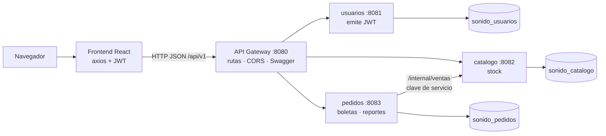

# Especificación de Requisitos de Software (ERS) — Sonido Vivo v3.1 (microservicios)

Formato: IEEE 830 simplificado · **Versión 3.1** · Fecha: 10-11-2026
Asignatura: DSY1104 Desarrollo Fullstack II (Duoc UC) · Evaluación Parcial 3
Equipo: Equipo de Desarrollo Sonido Vivo

> **Nota sobre versiones.** La v3.1 reemplaza a la v3.0 (06-11-2026), que describía un backend **monolítico** (`fase3/sonido-vivo-api`, que se conserva como respaldo). Por exigencia del docente, el backend se reorganiza en **tres microservicios de negocio** (usuarios, catálogo y pedidos), un **API Gateway** y una biblioteca compartida (`common`), con **una instancia MySQL de tres esquemas**. Para quien usa la tienda nada cambia: mismas pantallas, mismas rutas `/api/v1` y mismas reglas de negocio. Los requisitos RF-01 a RF-44 conservan su número; los que cambian por la arquitectura se marcan **(v3.1)**. Los requisitos nuevos parten en RF-45 y RNF-15. La sección 10 resume el paso del monolito a los microservicios.

| Fecha | Versión | Autor | Modificación |
|---|---|---|---|
| 11-09-2026 | 1.0 | Analista de Sistemas | Versión inicial: prototipo HTML/CSS/JS |
| 08-10-2026 | 2.0 | Equipo de Desarrollo Front | Reescritura para la Etapa 2 (React) |
| 16-10-2026 | 2.1 | Equipo de Desarrollo Front | Cupones, equivalencia v1 → v2, mejoras de navbar y portada |
| 06-11-2026 | 3.0 | Equipo de Desarrollo Sonido Vivo | Etapa 3: backend Spring Boot + MySQL (monolito), API REST `/api/v1` con Swagger, Spring Security + JWT con roles, reglas de negocio en el servidor, frontend con axios |
| 10-11-2026 | 3.1 | Equipo de Desarrollo Sonido Vivo | Microservicios: usuarios, catálogo y pedidos + API Gateway + `common`; 1 MySQL con 3 esquemas y un usuario por servicio; JWT HS256 con secreto compartido; venta interna idempotente entre pedidos y catálogo; Docker/compose; guía de despliegue en AWS Academy; 97 pruebas de backend |

---

## 1. Introducción

### 1.1 Propósito
Describir de forma completa y verificable lo que debe hacer la tienda online **Sonido Vivo** en su Etapa 3, con el frontend React integrado a un backend de microservicios. Está dirigido al equipo, al docente evaluador y a futuros mantenedores, para que todos compartan la misma definición del sistema y puedan comprobar que cada requisito tiene un componente que lo implementa y una prueba que lo verifica.

### 1.2 Alcance
Sonido Vivo es una tienda online de instrumentos musicales, audio y accesorios (Viña del Mar, Región de Valparaíso). El sistema tiene estas piezas:

- **Frontend (tienda + panel):** aplicación React (`fase3/proyecto_Etapa3_REACT`). La tienda incluye catálogo, búsqueda y filtros, categorías, ofertas, carrito con cupones, registro e inicio de sesión, checkout, confirmación de pago, blogs y contacto. El panel incluye dashboard, órdenes/boletas, productos (incluye críticos), categorías, usuarios, reportes y perfil.
- **Backend de microservicios (`fase3/backend-microservicios`):** proyecto Maven multimódulo con:
  - `usuarios` (8081): cuentas y autenticación; emite el JWT.
  - `catalogo` (8082): categorías, productos y stock.
  - `pedidos` (8083): boletas, historial y reportes.
  - `gateway` (8080): punto de entrada único del frontend.
  - `common`: biblioteca compartida, no es un microservicio.
- **Base de datos relacional:** una instancia **MySQL 8** con tres esquemas, `sonido_usuarios`, `sonido_catalogo` y `sonido_pedidos`, cada uno accedido solo por su microservicio con su propio usuario MySQL.

**Fuera de alcance:** pasarela de pago real (el pago sigue siendo simulado), envío real de correos, HTTPS propio y transacciones distribuidas (ver RF-47 y P-03). El despliegue en AWS Academy queda **preparado** (guía y scripts en `aws/`), y lo ejecuta el equipo en su sesión de laboratorio.

### 1.3 Definiciones, acrónimos y abreviaturas

| Término | Significado |
|---|---|
| ERS | Especificación de Requisitos de Software |
| SPA | *Single Page Application*: una sola página que cambia de vista sin recargar |
| API REST | Interfaz que el frontend usa por HTTP: recursos identificados por URL y operaciones GET/POST/PUT/DELETE |
| Endpoint | Combinación de método HTTP y ruta, por ejemplo `POST /api/v1/boletas` |
| Versionado de API | Prefijo `/api/v1` en todas las rutas públicas |
| Microservicio | Aplicación Spring Boot independiente, dueña de su esquema de datos, que se comunica con las demás por HTTP |
| API Gateway | Aplicación que recibe todas las peticiones del frontend y las reenvía al microservicio dueño de cada ruta |
| Esquema | En MySQL, sinónimo de base de datos (`CREATE DATABASE`): un espacio de tablas con sus propios permisos |
| Llamada interna | Petición entre microservicios (`/internal/**`) autenticada con una clave de servicio y no publicada por el Gateway |
| Idempotencia | Repetir la misma operación (por ejemplo, un reintento por red) produce el mismo resultado sin duplicar efectos |
| CRUD | Crear, obtener (leer), actualizar y eliminar |
| JWT | *JSON Web Token*: credencial firmada (HS256) que emite `usuarios` y que el frontend envía en `Authorization: Bearer <token>` |
| BCrypt | Algoritmo de *hash* de contraseñas con sal |
| JPA / Hibernate | Estándar de Java (y su implementación) para mapear clases a tablas |
| DTO | *Data Transfer Object*: forma de los datos que entra y sale de la API |
| CORS | Regla del navegador que exige que el servidor autorice explícitamente a otro origen (el frontend) |
| Swagger / OpenAPI | Especificación estándar de la API y su interfaz web interactiva |
| CLP | Peso chileno, entero; se muestra como `$129.990` |
| RUN | Rol Único Nacional chileno, con dígito verificador (`12345678-5`) |
| Stock crítico | Un producto es crítico cuando `stock <= stockCritico` (por defecto 3) |
| Boleta / orden | Registro de una compra (tabla BOLETA + DETALLE_BOLETA del esquema `sonido_pedidos`) |
| Personal | Usuarios con rol Administrador o Vendedor |

### 1.4 Referencias
- DSY1104 — Evaluación Parcial 3, Anexo 1: Instrucciones (roles, modelo de datos propuesto, criterios de evaluación).
- Referencia de microservicios entregada por el docente (GameTech EV3: `common` + 3 microservicios + Gateway).
- ERS v3.0 (06-11-2026, monolito) y v2.1 (16-10-2026).
- **APIs e Integración** (`docs/APIs_e_Integracion.md`), especificaciones **OpenAPI** (servidas por el Gateway en `/openapi/*`), **Manual de usuario** (`docs/Manual_de_Usuario.md`), **mapa de la rúbrica** (`docs/Mapa_Rubrica.md`) y scripts de despliegue **AWS** (`aws/`).
- Documentación de React, Vite, Vitest, axios, Spring Boot 3.5, Spring Cloud Gateway, Spring Security, Spring Data JPA, springdoc-openapi, jjwt, Docker y AWS (RDS, EC2, S3).

---

## 2. Descripción general

### 2.1 Perspectiva del producto

El frontend solo conserva en el navegador el **carrito** (`localStorage`) y la **sesión** (token y datos del usuario en `sessionStorage`). Catálogo, usuarios, boletas y stock viven en MySQL, repartidos entre los tres esquemas, y se consultan siempre a través del Gateway.

### 2.2 Usuarios y roles

Roles definidos por el enunciado de la Evaluación 3:

| Rol | Descripción | Puede |
|---|---|---|
| **Visitante** | Persona sin sesión | Ver catálogo, categorías, ofertas, blogs; usar el carrito; registrarse; iniciar sesión; **comprar sin cuenta** |
| **Cliente** | Usuario registrado (`Cliente`) | Solo la tienda: todo lo del visitante, con los datos autocompletados en el checkout, sus compras asociadas a su RUN y su perfil |
| **Vendedor** | Personal de la tienda (`Vendedor`) | Ver la **lista y el detalle de productos** y la **lista y el detalle de órdenes**. Ningún otro acceso del panel aparece en su vista, y la API le responde 403 en todo lo demás (incluido el perfil y "mis compras") |
| **Administrador** | Personal de la tienda (`Administrador`) | Acceso total: todo el panel y todos los endpoints públicos |

### 2.3 Restricciones
- **R-01** Backend con **Spring Boot 3.5** y **Java 21**, proyecto **Maven multimódulo** con Maven Wrapper. Spring Data JPA, driver MySQL, Spring Security, jjwt y springdoc-openapi; Gateway con **Spring Cloud Gateway** (WebFlux).
- **R-02** Base de datos relacional **MySQL 8**: **una instancia con tres esquemas**, uno por microservicio, cada uno con su propio usuario y permisos solo sobre su esquema. Sin claves foráneas entre esquemas. Para desarrollo y pruebas se usa **H2** (perfil por defecto `h2`); producción usa el perfil `mysql`. No se usa PostgreSQL ni Supabase.
- **R-03** Todas las rutas públicas llevan el prefijo **`/api/v1`** y están documentadas con **Swagger**, con un documento por microservicio reunidos en el Gateway.
- **R-04** Autenticación **sin estado** con **JWT HS256** y **secreto compartido** (`JWT_SECRET`): `usuarios` firma, y `catalogo` y `pedidos` solo validan. Autorización por rol en cada microservicio con Spring Security.
- **R-05** El frontend consume la API con **axios** a través del Gateway (`VITE_API_URL`). Stack heredado: Vite + React, react-router-dom, Bootstrap 5, Vitest.
- **R-06** El backend se versiona en un **repositorio GitHub propio y público** (`backend-microservicios`), separado del frontend, con commits en formato Conventional Commits.
- **R-07** Secretos (`JWT_SECRET`, `INTERNAL_API_KEY`, contraseñas de MySQL) y direcciones solo por **variables de entorno** (`.env` fuera de git). El perfil `mysql` no arranca si falta un secreto.
- **R-08** Correos aceptados solo de `@duoc.cl`, `@profesor.duoc.cl` y `@gmail.com`; se valida en el frontend **y** en el backend.
- **R-09** El pago y el envío de la boleta por email siguen siendo **simulados**.
- **R-10** Regiones y comunas: las 6 regiones de `src/utils/regiones-comunas.js` (heredado).
- **R-11** Ejecución con **Docker** (`Dockerfile` multimódulo con `ARG MODULE` y `compose.yaml`). Solo el Gateway publica un puerto (8080).
- **R-12** Despliegue objetivo en **AWS Academy**: una RDS MySQL 8 no pública, una EC2 con Docker y el frontend en S3 (`aws/`).

### 2.4 Supuestos y dependencias
- **S-01** El navegador soporta JavaScript moderno, `localStorage` y `sessionStorage`.
- **S-02** El frontend y el Gateway pueden estar en orígenes distintos; el Gateway debe tener el origen del frontend en `CORS_ORIGINS`.
- **S-03** Las imágenes de productos se cargan desde URL externas.
- **S-04** Cuentas de demostración que `usuarios` carga si su tabla está vacía (contraseñas con BCrypt):

  | Rol | Correo | Contraseña |
  |---|---|---|
  | Administrador | maria.perez@gmail.com | admin123 |
  | Vendedor | carlos.munoz@duoc.cl | vend123 |
  | Cliente | camila.rojas@gmail.com | cli123 |

- **S-05** `catalogo` carga 10 categorías y 51 productos si sus tablas están vacías; `pedidos` empieza vacío.
- **S-06** Los microservicios se alcanzan entre sí por una red privada (la red de Docker o la misma EC2).

---

## 3. Requisitos funcionales

Prioridad: **A** alta, **M** media. **(v3)** = requisito modificado en esta versión. Cada requisito se traza a componentes y pruebas en la sección 9.

### 3.1 Módulo Tienda

| ID | Requisito | Prio. |
|---|---|:-:|
| RF-01 **(v3)** | El sistema debe mostrar una portada con hero fotográfico, la sección **Explora las categorías** (una tarjeta por categoría con foto, nombre y lema, o su color y cantidad de productos si no tiene foto) y ofertas destacadas. Categorías y productos se obtienen de la API; mientras llegan se muestra "Cargando…" | M |
| RF-02 **(v3)** | El sistema debe listar el catálogo (desde `GET /api/v1/productos`) y permitir **buscar** por nombre, marca, modelo o código, filtrando en vivo sin una petición por tecla | A |
| RF-03 | El sistema debe permitir **filtrar** por categoría y mostrar la cantidad de resultados; sin coincidencias debe mostrar "No hay productos" | A |
| RF-04 **(v3)** | El sistema debe mostrar el **detalle** de un producto (`GET /api/v1/productos/{codigo}`) con selector de cantidad limitado al stock y botón **Añadir al carrito**. Un código inexistente (404) muestra "No se encontró el producto solicitado." | A |
| RF-05 **(v3)** | El sistema debe mostrar las **tarjetas de categorías** y, al elegir una (la selección vive en la URL), los productos de esa categoría (`GET /api/v1/productos?categoria={id}`) | A |
| RF-06 **(v3)** | El sistema debe tener una vista **Ofertas** (`GET /api/v1/productos?oferta=true`) con el precio normal tachado y el precio de oferta | A |
| RF-07 | Un producto en **stock crítico** muestra "Stock crítico"; uno sin stock muestra "Sin stock" y no se puede añadir | M |
| RF-08 | El **carrito** lista los productos, permite subir/bajar cantidades (en 0 se elimina), eliminar, limpiar y ver el total. Se guarda en el navegador | A |
| RF-09 | El navbar muestra siempre el **contador** de unidades del carrito | M |
| RF-10 **(v3)** | El sistema debe permitir **registrarse** (`POST /api/v1/auth/registro`) validando RUN con dígito verificador, nombre, apellidos, correo (formato y dominio), región → comuna, dirección y contraseña de 4 a 10 caracteres con confirmación. La cuenta creada siempre es `Cliente`. El backend rechaza RUN o correo repetidos (409) y la sesión queda iniciada | A |
| RF-11 **(v3)** | El sistema debe permitir **iniciar sesión** (`POST /api/v1/auth/login`), validando en vivo y mostrando "Correo o contraseña incorrectos." cuando la API responde 401. Al entrar, el Administrador va al Dashboard, el Vendedor a Productos del panel y el Cliente a la tienda | A |
| RF-12 | El navbar muestra "Iniciar sesión / Registrarse" sin sesión, o el nombre del usuario y "Cerrar sesión" con sesión (y "Admin" al personal). Carrito e Iniciar/Cerrar sesión siempre visibles | A |
| RF-13 **(v3)** | El **checkout** captura datos del cliente y de entrega, los valida y los **autocompleta** si hay sesión. **No exige iniciar sesión**: a un visitante le ofrece iniciar sesión de forma opcional. Con el carrito vacío avisa que no hay nada que pagar | A |
| RF-14 **(v3)** | Al pagar, el frontend envía `POST /api/v1/boletas` **solo con códigos y cantidades**. Si el backend acepta, se vacía el carrito y se muestra **PagoCorrecto** con el número de boleta, datos de entrega, resumen (con los montos calculados por el backend) y los botones **Imprimir boleta** y **Enviar por email** (simulado). Si el backend rechaza la compra (stock insuficiente, cupón inválido, error de red), se muestra su mensaje y se conserva el carrito | A |
| RF-15 | Si el pago simulado falla (casilla "Simular error de pago"), el sistema muestra **PagoError**, conserva el carrito y ofrece **Volver a realizar el pago** (no se llama a la API) | A |
| RF-16 | Página **Nosotros** | M |
| RF-17 **(v3)** | **Blogs** y **detalle de blog** con enlace a la categoría relacionada. Son contenido estático del frontend (no forman parte del modelo de datos) | M |
| RF-18 | Formulario de **Contacto** (nombre y comentario obligatorios, correo opcional validado, contador de 500 caracteres) con confirmación simulada | M |
| RF-29 | El carrito permite **aplicar un cupón** (`SONIDOVIVO10` 10 %, `BIENVENIDO5` 5 %, sin distinguir mayúsculas ni espacios) con sus mensajes de válido / inválido y la opción de quitarlo | M |
| RF-30 **(v3)** | Con cupón, carrito, checkout y boleta muestran subtotal, descuento y total. En el carrito es una **vista previa**: el monto definitivo lo calcula y guarda el backend en la boleta | M |

### 3.2 Módulo Administración

| ID | Requisito | Prio. |
|---|---|:-:|
| RF-19 **(v3)** | El acceso a `/admin/*` está restringido a **Administrador** y **Vendedor** con sesión válida (token). Cada ruta del panel exige un permiso: si el rol no lo tiene, se muestra "No tienes permisos para ver esta sección." sin llamar a la API | A |
| RF-20 **(v3)** | El **Dashboard** (solo Administrador) muestra compras y total vendido, productos y cuántos están críticos, usuarios, y accesos rápidos | A |
| RF-21 **(v3)** | El panel lista las **órdenes** (`GET /api/v1/boletas`, más recientes primero, marcando las compras "Invitado") y muestra la **boleta** imprimible (`GET /api/v1/boletas/{id}`). Disponible para Administrador y Vendedor | A |
| RF-22 **(v3)** | El panel permite **listar (con búsqueda), crear, editar y eliminar productos** (solo Administrador). El código es único y no se edita; la categoría se elige de las existentes. Validaciones en frontend y backend: código 3 a 20 caracteres, nombre máx. 100, descripción máx. 500, precio entero ≥ 0, stock entero ≥ 0, stock crítico entero opcional (3 por defecto), precio de oferta obligatorio si está en oferta y ≤ precio normal | A |
| RF-23 **(v3)** | El panel tiene el listado de **productos críticos** (`GET /api/v1/productos/criticos`, solo Administrador) | A |
| RF-24 **(v3)** | El panel permite **listar, crear, editar y eliminar categorías** (solo Administrador). El id se deriva del nombre; no se permiten nombres repetidos (409); no se puede eliminar una categoría con productos (409). Al renombrar, los productos muestran el nombre nuevo porque guardan la clave foránea | A |
| RF-25 **(v3.1)** | El panel permite **listar, crear, editar y eliminar usuarios** (solo Administrador). RUN y correo únicos; al editar, contraseña vacía = se conserva; nadie puede eliminarse a sí mismo; al eliminar un usuario sus boletas se conservan **con su RUN** como dato histórico (están en otro microservicio) | A |
| RF-26 | El panel muestra el **historial de compras** de un usuario (solo Administrador) | M |
| RF-27 **(v3.1)** | **Reportes** (solo Administrador): total vendido, ticket promedio, unidades en stock, 5 productos más vendidos y ventas por categoría, **calculados por el backend** (`GET /api/v1/reportes/ventas`, microservicio pedidos). Las unidades en stock las informa catálogo; si no responde, se muestra "—" y el resto del reporte sigue | M |
| RF-28 **(v3)** | **Perfil** (solo Administrador en la interfaz): editar los datos propios con `PUT /api/v1/usuarios/me`, que no acepta RUN, correo ni tipo de usuario | M |

### 3.3 Backend, API e integración

| ID | Requisito | Prio. |
|---|---|:-:|
| RF-31 **(v3.1)** | El backend debe exponer una **API REST versionada** en `/api/v1` con 27 operaciones públicas repartidas en tres microservicios: autenticación, perfil y CRUD de usuarios (`usuarios`); CRUD de productos y categorías (`catalogo`); creación y consulta de boletas, historial y reportes (`pedidos`). Ver la sección 4 de APIs e Integración | A |
| RF-32 **(v3.1)** | `usuarios` debe **autenticar** con correo y contraseña y entregar un **JWT HS256** (`sub` = RUN, `rol`, `nombre`, `correo`, vigencia configurable, 2 horas por defecto). El frontend lo guarda en la sesión y un interceptor de axios lo envía en cada petición | A |
| RF-33 **(v3.1)** | **Cada microservicio** debe autorizar por rol sus endpoints según la matriz 3.3 de APIs e Integración: 401 sin token o con token inválido o vencido, 403 si el rol no tiene permiso, y 403 en cualquier ruta no declarada | A |
| RF-34 **(v3.1)** | El **Vendedor** solo debe poder ver la lista y el detalle de productos y de órdenes (además de `/auth/login` y `/auth/me`). El menú solo muestra esas dos secciones, sin crear, editar ni eliminar, y la API le responde 403 en críticos, escritura de catálogo, usuarios, `/usuarios/me`, `/usuarios/me/boletas` y reportes | A |
| RF-35 **(v3.1)** | El checkout debe hacerse **sin confiar en los montos del cliente**. `pedidos` valida el cupón y pide a `catalogo` los precios vigentes. `catalogo` agrupa ítems, bloquea por código en orden, valida el stock de **todos** (si uno falla: 409 y no descuenta nada), descuenta en una transacción y devuelve precio, nombre y categoría. `pedidos` calcula subtotal, descuento y total y guarda BOLETA + DETALLE_BOLETA | A |
| RF-36 **(v3.1)** | Se debe poder **comprar sin iniciar sesión**. Con un token válido la boleta guarda el RUN del token; sin token, `usuario_run` queda NULL. Los datos del comprador y de la entrega se copian en la boleta | A |
| RF-37 | Una boleta solo la puede consultar el **personal** o su **dueño**: un cliente que pide la boleta de otra persona recibe 403 y un visitante 401 | A |
| RF-38 **(v3.1)** | Cada microservicio publica su OpenAPI 3 (`/v3/api-docs`). El **Gateway** ofrece una sola **Swagger UI** (`/swagger-ui.html`) con un selector Usuarios, Catálogo y Pedidos, y con el esquema Bearer. Los documentos los sirve el Gateway en `/openapi/{usuarios,catalogo,pedidos}` | A |
| RF-39 **(v3.1)** | Los tres microservicios responden los errores con el **mismo JSON** (`estado`, `error`, `mensaje`, `ruta`, `fecha` y `errores` por campo), definido una sola vez en `common` | M |
| RF-40 | Si el backend responde 401 a una petición que llevaba token (sesión vencida), el frontend cierra la sesión y avisa "Tu sesión expiró…" | M |
| RF-41 **(v3.1)** | Un producto que ya se vendió **no se puede eliminar** (409). `catalogo` lo sabe por su propio comprobante de ventas (`venta_registrada`), sin consultar el esquema de pedidos | M |
| RF-42 | El panel tiene una **ficha de producto de solo lectura** para Administrador y Vendedor; el botón Editar solo aparece al Administrador | M |
| RF-43 **(v3.1)** | La API ofrece datos propios (`GET /auth/me` a cualquier autenticado; `GET/PUT /usuarios/me` a Administrador y Cliente) e **historial de compras** (`GET /usuarios/me/boletas`, atendido por `pedidos`) | M |
| RF-44 | Si la API no responde, cada pantalla con datos muestra un error de conexión y un botón **Reintentar** | M |

### 3.4 Microservicios (nuevos en la v3.1)

| ID | Requisito | Prio. |
|---|---|:-:|
| RF-45 | El frontend debe usar **un único punto de entrada**, el API Gateway (8080). El Gateway envía `/auth/**` y `/usuarios/**` a `usuarios`, `/productos/**` y `/categorias/**` a `catalogo`, y `/boletas/**`, `/reportes/**`, `/usuarios/me/boletas` y `/usuarios/{run}/boletas` a `pedidos`. Estas dos últimas tienen prioridad sobre `/usuarios/**` | A |
| RF-46 | La comunicación **pedidos → catalogo** debe usar la ruta interna `/internal/ventas` con la clave `X-Internal-Api-Key` (`INTERNAL_API_KEY`). El Gateway no publica `/internal/**` (404), sin clave responde 401 e incluso un Administrador con JWT recibe 403 | A |
| RF-47 | La venta interna debe ser **idempotente** por número de boleta: repetir la misma referencia devuelve el mismo comprobante sin descontar otra vez, y la misma referencia con otros ítems responde 409. Ante una falla de red, `pedidos` reintenta una vez con la misma referencia; si sigue fallando responde 503 y la boleta queda *Pendiente* (no visible en listados ni reportes) | A |
| RF-48 | `POST /boletas` debe aceptar un encabezado opcional **`Idempotency-Key`**. Con la misma clave y el mismo contenido devuelve la boleta ya creada; con otro contenido responde 409. El checkout envía una clave por visita | M |
| RF-49 | Las boletas se numeran **desde 1001**. Una compra rechazada (409 o 404 desde catálogo) borra su boleta pendiente, por lo que puede haber huecos en la numeración | M |
| RF-50 | El detalle de boleta debe guardar **código, nombre, categoría y precio** del producto al momento de la venta. Así los reportes (más vendidos, ventas por categoría) se calculan en `pedidos` sin consultar a otro servicio | A |
| RF-51 | `catalogo` debe exponer `/internal/inventario` (unidades en stock) para el reporte. Si no responde, el reporte devuelve `unidadesEnStock: null` y el resto de los datos | M |
| RF-52 | Cada servicio debe exponer `/actuator/health` (público, sin detalles), que usan los healthcheck de Docker y el orden de arranque de `compose.yaml` | M |
| RF-53 | Cada servicio debe cargar su **semilla** si sus tablas están vacías: `usuarios` los 3 usuarios demo con BCrypt y `catalogo` las 10 categorías y 51 productos (`SEMILLA=false` la desactiva) | M |

---

## 4. Requisitos no funcionales

| ID | Categoría | Requisito | Cómo se cumple |
|---|---|---|---|
| RNF-01 | Responsividad | Interfaz usable desde móvil (≈375 px) hasta escritorio | Bootstrap 5 (heredado) |
| RNF-02 | Usabilidad | Validación en vivo, confirmación de acciones destructivas, estados vacíos, de carga y de error | `FormField`, `ConfirmButton`, `EstadoCarga` (heredado) |
| RNF-03 | Rendimiento | La navegación no recarga la página; el catálogo se filtra al instante | SPA; el catálogo se pide una vez y se filtra en el navegador |
| RNF-04 **(v3.1)** | Mantenibilidad | Separación por servicio y por capas | Cada microservicio tiene `controller` → `service` → `repository` → `model`, con `dto`, `exception` y `config` (más `client` y `mapper` en pedidos). Lo común está una sola vez en `common` |
| RNF-05 **(v3.1)** | Persistencia y aislamiento | Cada servicio es dueño de sus datos | Un esquema MySQL por servicio con usuario propio (`GRANT` solo sobre su esquema); claves foráneas solo dentro de cada esquema; referencias entre servicios por ID |
| RNF-06 **(v3.1)** | Consistencia | Nunca se vende más stock del que hay, ni con compras simultáneas ni con reintentos | Transacción en catálogo con `SELECT … FOR UPDATE` en orden de código, validación de todo antes de descontar, comprobante idempotente por referencia y `Idempotency-Key` en pedidos |
| RNF-07 **(v3.1)** | Seguridad | Contraseñas protegidas, acceso por rol, datos sensibles fuera del código, red interna protegida | BCrypt; JWT HS256 con vencimiento y secreto solo en variables de entorno; servicios sin estado (CSRF no aplica); CORS solo en el Gateway, limitado a `CORS_ORIGINS`; clave de servicio con comparación en tiempo constante; solo el puerto 8080 publicado; contenedores con usuario sin privilegios; la API nunca devuelve la contraseña |
| RNF-08 | Seguridad en el cliente | El frontend no es la barrera de seguridad | El rol de la sesión solo decide qué se muestra; toda operación se autoriza en el servidor |
| RNF-09 **(v3.1)** | Configurabilidad | Cambiar de H2 a MySQL local o a RDS sin tocar código | Perfiles `h2` y `mysql`; `DB_URL`, `DB_USER`, `DB_PASSWORD` por servicio, `JWT_SECRET`, `INTERNAL_API_KEY`, `CATALOGO_URL`, `CORS_ORIGINS`; `VITE_API_URL` en el frontend |
| RNF-10 **(v3.1)** | Documentación de API | Cualquier integrante puede conocer y probar la API sin leer el código | Swagger UI agregado en el Gateway, con descripciones, códigos de respuesta y Authorize; documentos en `/openapi/*` del Gateway |
| RNF-11 **(v3.1)** | Testabilidad | Lógica de negocio probada en cada servicio, más pruebas de punta a punta | 97 pruebas de backend (JUnit 5, Mockito, MockMvc, DataJpaTest), cobertura JaCoCo del 92,6 % de líneas; 192 pruebas de frontend; 6 de integración real; humo con 38 comprobaciones |
| RNF-12 | Identidad de marca | Nombre, colores y logo de Sonido Vivo | Heredado de la v2 |
| RNF-13 **(v3.1)** | Portabilidad | Ejecutar igual en cualquier equipo o en la nube | Maven Wrapper, bytecode Java 21, imágenes Docker, `compose.yaml` y plan B sin Docker (`scripts/iniciar-h2.ps1`) |
| RNF-14 **(v3.1)** | Colaboración | Historial de cambios claro y repositorios separados | Backend en su repositorio público con commits pequeños (`feat:`, `test:`, `chore:`, `docs:`) |
| RNF-15 | Disponibilidad parcial | Que la caída de un servicio no tumbe todo | Si catálogo cae, el reporte responde sin `unidadesEnStock` y el checkout responde 503 sin duplicar cobros; cada consulta HTTP interna tiene tiempo máximo (5 s); los contenedores se reinician solos (`restart: unless-stopped`) |
| RNF-16 | Observabilidad mínima | Saber si cada servicio está arriba | `/actuator/health` en los 4 servicios y healthchecks en compose |

---

## 5. Modelo de datos

Basado en la **Figura 1** del enunciado (USUARIO ┄▸ BOLETA → DETALLE_BOLETA ← PRODUCTO ← CATEGORIA), repartido entre los esquemas de cada microservicio:

| Esquema (servicio) | Tablas | Relaciones con clave foránea |
|---|---|---|
| `sonido_usuarios` (usuarios) | USUARIO | — |
| `sonido_catalogo` (catalogo) | CATEGORIA, PRODUCTO, VENTA_REGISTRADA, VENTA_LINEA | PRODUCTO → CATEGORIA; VENTA_LINEA → VENTA_REGISTRADA |
| `sonido_pedidos` (pedidos) | BOLETA, DETALLE_BOLETA (+ `boleta_seq`) | DETALLE_BOLETA → BOLETA |

Las dos relaciones del enunciado que cruzan servicios pasan a ser **referencias por ID sin clave foránea**: `BOLETA.usuario_run` (RUN del JWT, NULL si la compra es sin cuenta) y `DETALLE_BOLETA.codigo_producto` (con copia de nombre, categoría y precio). Los diagramas por esquema y las columnas, obtenidas del MySQL real, están en APIs e Integración, sección 2.

**Decisiones de modelado:**
- **Claves naturales** donde ya existían: RUN, código de producto y *slug* de categoría. Las URL del frontend no cambian.
- **Copia de datos en la boleta:** datos del comprador, de la entrega, y nombre, categoría y precio de cada producto al momento de la venta.
- **Comprobante de ventas en catálogo** (`VENTA_REGISTRADA`/`VENTA_LINEA`): idempotencia de la venta interna y regla de "producto vendido no se elimina", sin leer otro esquema.
- **Montos en pesos enteros** (`int`).
- **Cupones y blogs no son tablas:** los cupones son una enumeración de `pedidos` y los blogs son contenido estático del frontend.

---

## 6. Casos de uso principales

Se mantienen los de la v3.0 (CU-01 a CU-08: explorar catálogo, comprar, registrarse/iniciar sesión, consultar productos, consultar órdenes, gestionar productos, gestionar categorías y usuarios, ver reportes). Cambia el flujo interno de **CU-02 Comprar productos**:

> Ir a pagar → completa el checkout → **Pagar ahora** → el Gateway envía la compra a `pedidos` → `pedidos` valida el cupón y crea la boleta pendiente → `catalogo` valida y descuenta el stock de todos los ítems con los precios reales → `pedidos` calcula el total y marca la boleta como pagada → PagoCorrecto con el número de boleta (desde 1001). *Alternos:* datos inválidos → errores junto al campo; stock insuficiente → 409 con el mensaje de catálogo y carrito intacto; cupón inválido → 400; catálogo no disponible → 503 y, al reintentar, la misma `Idempotency-Key` evita una segunda boleta; pago simulado con error → PagoError.

---

## 7. Mapa de navegación

Sin cambios respecto a la v3.0: las rutas de la tienda y del panel son las mismas. Tras el login, el Administrador va a `/admin`, el Vendedor a `/admin/productos` y el Cliente a la tienda. Si un Vendedor escribe a mano una ruta "solo Administrador", ve "No tienes permisos para ver esta sección.".

---

## 8. Arquitectura y stack tecnológico

| Capa | Tecnología | Uso |
|---|---|---|
| Interfaz | React 19, react-router-dom 7, Bootstrap 5.3 | SPA con rutas protegidas por permiso |
| Cliente HTTP | axios | `baseURL` = Gateway (`VITE_API_URL`), interceptor del token y de sesión vencida, `Idempotency-Key` en el checkout |
| Entrada | **Spring Cloud Gateway 2025.0** (WebFlux) | Rutas por microservicio, CORS, Swagger agregado, `/internal` sin ruta |
| Microservicios | **Spring Boot 3.5.13**, Java 21 (`--release 21`) | `usuarios`, `catalogo` y `pedidos`, cada uno con web, validation, data-jpa, security y actuator |
| Biblioteca común | `common` (jar Maven) | Errores uniformes, JWT (jjwt 0.12), filtro de clave interna, base de seguridad, OpenAPI, utilidades |
| Persistencia | Spring Data JPA (Hibernate 6), MySQL 8 (3 esquemas), H2 en desarrollo y pruebas | Repositorios, bloqueo pesimista, secuencia de boletas desde 1001 |
| Comunicación interna | `RestClient` de Spring con tiempo máximo | pedidos → catalogo con `X-Internal-Api-Key` |
| Documentación | springdoc-openapi 2.8 | Un OpenAPI por servicio y la Swagger UI en el Gateway |
| Contenedores | Docker, `compose.yaml` (MySQL 8.4 + 4 servicios) | Healthchecks, solo el 8080 publicado |
| Nube (preparado) | AWS Academy: RDS MySQL 8, EC2 Amazon Linux 2023, S3 | `aws/aprovisionar.ps1`, `aws/compose.rds.yaml` |
| Pruebas | JUnit 5, Mockito, MockMvc, spring-security-test, DataJpaTest, JaCoCo; Vitest | Por servicio, de integración real y de humo |

**Decisiones de diseño (para la exposición oral):**
- *¿Por qué tres servicios?* Siguen los límites del negocio: quién es la persona (usuarios), qué se vende (catálogo) y qué se vendió (pedidos). Cada uno tiene una sola base y un solo motivo para cambiar.
- *¿Por qué una instancia MySQL y no tres?* En AWS Academy cada RDS consume crédito. Tres esquemas con tres usuarios dan el mismo aislamiento lógico: ningún servicio puede leer las tablas de otro.
- *¿Por qué JWT con secreto compartido?* Así catálogo y pedidos validan el token sin llamar a usuarios en cada petición. La alternativa más estricta (RS256 con claves pública y privada, como la referencia) se deja anotada como mejora.
- *¿Por qué el precio lo pone catálogo?* Porque es el dueño del precio y del stock. El navegador solo manda qué y cuánto quiere comprar.
- *¿Por qué no hay transacción distribuida?* Coordinar dos bases (2PC) agrega mucha complejidad. En su lugar: boleta pendiente, venta idempotente, reintento acotado y un límite documentado (RF-47).
- *¿Por qué el historial está bajo `/usuarios` si lo atiende pedidos?* Para no cambiar las rutas del frontend. El Gateway decide a quién va cada ruta, y así no se duplican boletas en usuarios.

---

## 9. Plan de pruebas y trazabilidad

### 9.1 Plan y resultados (10-11-2026)

| Suite | Herramientas | Resultado |
|---|---|---|
| Backend `common` | JUnit 5 + MockMvc standalone | 21 pruebas ✔ |
| Backend `usuarios` | Mockito, `@SpringBootTest` + MockMvc, `@DataJpaTest` | 19 pruebas ✔ |
| Backend `catalogo` | Mockito, `@SpringBootTest` + MockMvc, `@DataJpaTest` | 24 pruebas ✔ |
| Backend `pedidos` | Mockito, `@SpringBootTest` + MockMvc + `@MockitoBean` del cliente de catálogo, servidor HTTP de prueba, `@DataJpaTest` | 27 pruebas ✔ |
| Backend `gateway` | `@SpringBootTest` (puerto real) + servicios falsos | 6 pruebas ✔ |
| **Total backend** | `./mvnw clean verify` | **97 pruebas, 0 fallos** · JaCoCo: 93,0 % de instrucciones y 92,6 % de líneas |
| Frontend | Vitest + Testing Library + servidor falso | **192 pruebas, 0 fallos** · líneas 99,2 % |
| Integración real | `npm run test:integracion` contra el Gateway (Docker + MySQL) | **6 pruebas, 0 fallos** |
| Humo de punta a punta | `scripts/humo.ps1` | **38 / 38** con Docker + MySQL y **38 / 38** con el plan B en H2 |

### 9.2 Matriz de trazabilidad (requisito ↔ implementación ↔ prueba)

| Requisito | Implementación (backend) | Pruebas |
|---|---|---|
| RF-01 a RF-07 | `catalogo`: `ProductosController`, `CategoriasController`, `ProductoService.listar` | `CatalogoApiTest.catalogoPublicoConFiltros`, `CatalogoReglasTest.filtrosDeBusquedaYOfertas`, `CatalogoRepositoryTest`; FE `paginas`, `componentes` |
| RF-10, RF-11, RF-32 | `usuarios`: `AuthService`, `UsuarioService.crear`; `common`: `JwtUtil`, `FiltroJwt` | `UsuariosApiTest.loginDeLosTresRoles…`, `registroCreaSiempreCliente…`, `elTokenLlevaRunRolNombreYCorreo`; `JwtUtilTest`; FE `paginas` |
| RF-13, RF-14, RF-30, RF-35, RF-36, RF-50 | `pedidos`: `BoletaService`, `BoletaStore`, `Cupon`; `catalogo`: `VentaService` | `BoletaServiceTest` (11), `VentaServiceTest` (7), `PedidosApiTest.compraSinCuentaConCupon…`, `compraConSesion…`; humo, sección 3; FE `pago` |
| RF-19, RF-33, RF-34 | `SecurityConfig` de cada servicio; `common`: `SeguridadBase` | `UsuariosApiTest.listaDeUsuariosSoloAdministrador`, `perfilPropio…NoVendedor`; `CatalogoApiTest.vendedorSoloLeeProductos`; `PedidosApiTest.permisosDelVendedor…`; humo, sección 4; FE `vendedor` |
| RF-21, RF-37 | `pedidos`: `BoletaService.obtener`/`listar` | `BoletaServiceTest.unClienteSoloVeSusBoletas…`, `PedidosApiTest.compraConSesionQuedaEnElHistorial…`; FE `admin` |
| RF-22, RF-23, RF-41, RF-42 | `catalogo`: `ProductoService`, `VentaRegistradaRepository.existeVentaDelProducto` | `CatalogoApiTest.crudDeProducto…`, `ventaInternaDescuentaUnaVezYBloqueaEliminarElProducto`, `CatalogoReglasTest.noSeEliminaUnProductoConVentas` |
| RF-24 | `catalogo`: `CategoriaService` | `CatalogoReglasTest.categoriaUnica…`, `CatalogoApiTest.categoriasCrudYNoEliminarConProductos` |
| RF-25, RF-26, RF-28, RF-43 | `usuarios`: `UsuarioService`; `pedidos`: `HistorialController` | `UsuarioServiceTest` (7), `UsuariosApiTest.crudCompletoDelAdministrador`, `elAdministradorNoPuedeEliminarseASiMismo` |
| RF-27, RF-51 | `pedidos`: `ReporteService`, `CatalogoCliente.unidadesEnStock`; `catalogo`: `/internal/inventario` | `PedidosApiTest.reporteSoloAdministradorYToleraCatalogoCaido`, `CatalogoClienteTest`; FE `admin` (reporte con "—") |
| RF-38 | `common`: `OpenApiConfig`; `gateway`: rutas `/openapi/*` | `RutasGatewayTest.reenviaElTokenYLosDocumentosDeSwagger`, `saludParaDockerYSwaggerUi` |
| RF-39 | `common`: `ApiErrors`, `ErrorRespuesta` | `ApiErrorsTest` (3) |
| RF-45 | `gateway`: `RoutesConfig`, `CorsConfig` | `RutasGatewayTest.cadaRutaLlega…`, `elHistorialBajoUsuariosLoAtiendePedidos`, `corsPermiteSoloLosOrigenesConfigurados` |
| RF-46 | `common`: `ClaveInternaFiltro`; `catalogo`: `InternalController` | `FiltrosTest.claveInterna…`, `CatalogoApiTest.ventaInternaExigeClaveDeServicio`, `RutasGatewayTest.lasRutasInternasNoSePublican` |
| RF-47, RF-48 | `catalogo`: `VentaService` (referencia); `pedidos`: `BoletaService` (reintento, huella) | `VentaServiceTest.reintentoConLaMismaReferencia…`, `BoletaServiceTest.fallaDeRed…`, `siCatalogoSigueCaido…`, `mismaClave…`; `PedidosApiTest.idempotencyKeyEvitaUnaSegundaBoleta`; FE `pago` (misma clave al reintentar) |
| RF-49 | `pedidos`: `Boleta` (`boleta_seq`, initialValue 1001) | `BoletaRepositoryTest.laNumeracionEmpiezaEn1001…`; verificación en MySQL (sección 7.5 de APIs e Integración) |
| RF-52, RF-53 | actuator; `Seed` de usuarios y catalogo | Healthchecks de compose (5/5 *healthy*); `UsuariosApiTest` y `CatalogoApiTest` usan la semilla real |
| RNF-05 | `sql/01_crear_esquemas_mysql.sql`, `sql/docker/01_init.sh` | `SHOW GRANTS` y `ERROR 1142` entre esquemas (APIs e Integración, sección 2.4) |

---

## 10. Qué cambió: del monolito a los microservicios

| Aspecto | v3.0 (monolito `sonido-vivo-api`) | v3.1 (`backend-microservicios`) |
|---|---|---|
| Despliegue | Un jar, un proceso, puerto 8080 | 4 aplicaciones (Gateway + 3 servicios) y la biblioteca `common`; Docker/compose |
| Base de datos | Un esquema con 5 tablas y claves foráneas entre todas | 1 instancia MySQL con 3 esquemas y 3 usuarios; claves foráneas solo dentro de cada esquema |
| Paquetes | `controlador`, `servicio`, `repositorio`, `modelo`… | `controller`, `service`, `repository`, `model`, `dto`, `exception`, `config` (+ `client`, `mapper`), como la referencia |
| JWT | Firma y validación en el mismo proceso | `usuarios` firma; `catalogo` y `pedidos` validan con el secreto compartido |
| Checkout | Una transacción local con bloqueo | Boleta pendiente → venta interna idempotente en catálogo → boleta pagada; reintento y `Idempotency-Key` |
| Producto vendido no se elimina | Consulta a `detalle_boleta` | Comprobante propio de catálogo (`venta_registrada`) |
| Eliminar usuario | Sus boletas quedaban sin dueño (`run` NULL) | Sus boletas conservan el RUN (otro servicio, dato histórico) |
| Reportes | Leían boletas y productos | Se calculan en pedidos con nombre y categoría del detalle; stock pedido a catálogo |
| Swagger | Un documento | Uno por servicio, con selector en el Gateway |
| Perfiles | `h2`, `supabase`, MySQL por defecto | `h2` por defecto y `mysql` (sin PostgreSQL ni Supabase) |
| Permisos del Vendedor | Podía ver su perfil y sus compras | 403 en `/usuarios/me` y `/usuarios/me/boletas` (solo productos y órdenes) |
| Pruebas backend | 76 | 97, con JaCoCo, más humo de punta a punta |
| Frontend | — | Mismas rutas; se agrega `Idempotency-Key` en el checkout, "—" en reportes y la URL de la API en `deploy-s3.ps1` |

**Se mantuvo:** rutas `/api/v1` y formas de respuesta, cuentas demo, catálogo de 51 productos en 10 categorías, validaciones (RUN, dominios de correo, largos), cupones, reglas de negocio y diseño de la tienda.

---

## 11. Pendientes y riesgos

| ID | Tema | Estado / mitigación |
|---|---|---|
| P-01 | Despliegue en AWS Academy | Preparado y no ejecutado: `aws/aprovisionar.ps1`. Plan B local documentado |
| P-02 | HTTPS | El sitio web de S3 y el Gateway son HTTP. Con CloudFront (HTTPS) la API también debe ser HTTPS (ver la guía AWS) |
| P-03 | Transacción distribuida | No existe; si se pierde dos veces la respuesta de catálogo, la boleta queda *Pendiente* con stock descontado hasta reintentar con la misma `Idempotency-Key` (RF-47). No hay conciliación automática |
| P-04 | Secreto JWT compartido (HS256) | Quien valida podría firmar; se mitiga guardando el secreto solo en el servidor. Mejora futura: RS256 con clave pública |
| P-05 | Migraciones de esquema | `ddl-auto=update` en el primer arranque; después `DDL_AUTO=validate`. Mejora futura: Flyway |
| P-06 | Vista "Mis compras" del cliente | El endpoint existe (`GET /usuarios/me/boletas`); falta la pantalla |
| P-07 | Pasarela de pago y correo reales | Fuera de alcance; siguen simulados |
| P-08 | JDK del equipo | Las pruebas se ejecutaron con JDK 26 compilando para Java 21; la imagen Docker usa JDK/JRE 21. Se recomienda instalar JDK 21 para igualar ambos entornos |
